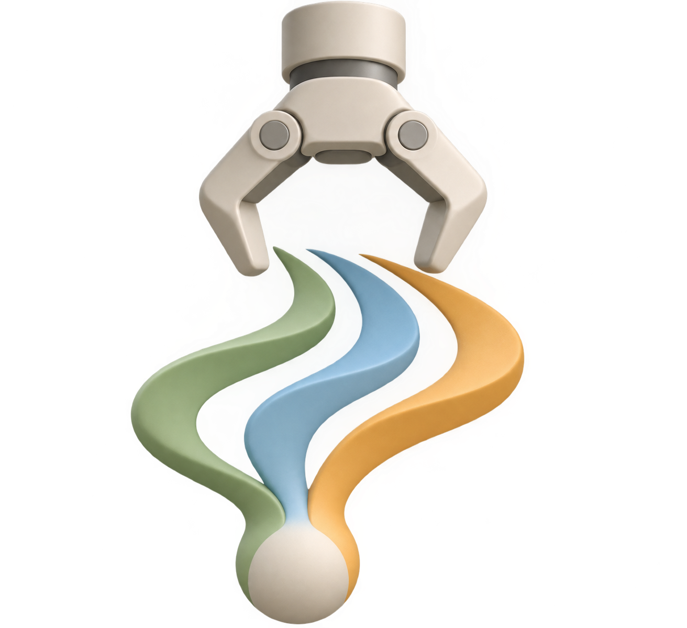
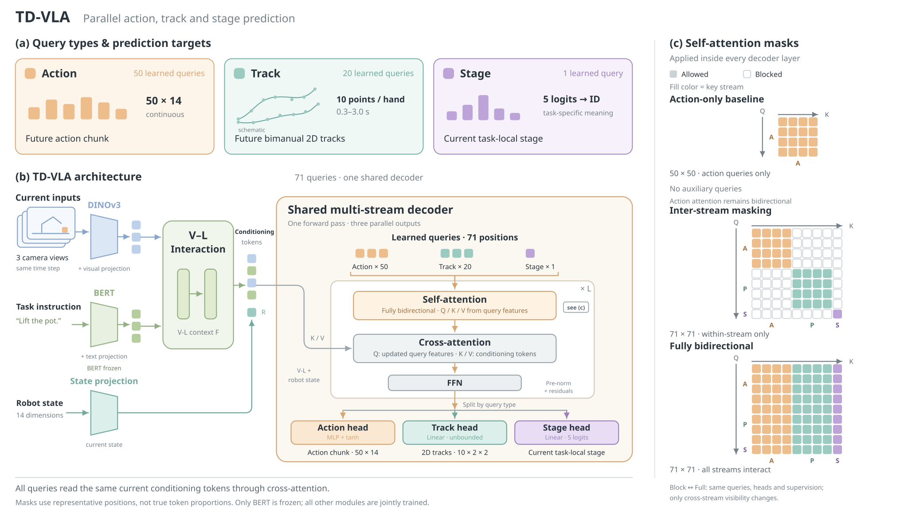

  
  <h1>TD-VLA</h1>
  
<strong>Joint modeling of actions, trajectories and task stages</strong>

  
<a href="README.md">中文</a> · English

  
<a href="#method-overview">Method overview</a> · <a href="#three-output-streams">Three output streams</a> · <a href="#documentation">Documentation</a>

## Overview

Can a robot policy express intended future motion and current task progress while predicting actions? Built on TurboVLA's parallel action chunks, TD-VLA introduces **Action, Track and Stage** queries into a shared decoder to jointly predict continuous actions, future 2D gripper trajectories and task-local stages.

Current observations and the task instruction provide shared conditioning. The streams exchange hidden features and produce predictions together. The first version uses fully bidirectional cross-stream attention without introducing cross-window history; Track and Stage provide auxiliary supervision for action learning.

## Method overview

<a href="docs/model-architecture-v1.md">Model architecture</a> · <a href="docs/data/p2-annotation-rules.md">Track / Stage annotations</a> · <a href="src/td_vla/models/multistream.py">Implementation</a>

Multi-view images, task instructions and robot state form the conditioning input. Action queries, Track queries and a Stage query pass through a shared Transformer decoder, followed by separate output heads. Joint modeling occurs through parallel query features; this is not stream-by-stream autoregressive generation conditioned on sampled actions.

## Three output streams

| Stream | Prediction | Supervision | Loss |
| --- | --- | --- | --- |
| **Action** | Continuous dual-arm action chunks | Expert actions with the baseline action convention and normalization | L1 |
| **Track** | Future 2D trajectories of each gripper's two-finger midpoint | Geometry from successful expert trajectories projected into the current main camera | Smooth L1 |
| **Stage** | Current task-local stage | Stage intervals determined from simulator Oracle transition events | Cross-entropy |

Track uses actual timestamps for future samples and has a horizon independent of the action chunk. Both arms remain supervised; occlusion or leaving the image alone does not invalidate a target. These targets represent expert motion, not a guarantee of the deployed policy's actual trajectory.

Stage uses a shared five-class head with task-specific stage semantics. Oracle information and future evidence are used for offline annotation, not as current policy inputs. See the [v4 annotation protocol](docs/data/p2-annotation-rules.md) for validity masks and decoding, and [losses.py](src/td_vla/training/losses.py) for the objectives.

## Documentation

**Suggested order:** [Architecture](docs/model-architecture-v1.md) → [Annotations](docs/data/p2-annotation-rules.md) → [Environments](docs/setup/uv-environments.md) → [Training](docs/setup/pretrained-training-v1.md).

Detailed technical documents are primarily maintained in Chinese.

| Topic | Entry points | Coverage |
| --- | --- | --- |
| Original usage notes | [Complete usage guide](docs/usage-guide.md) | Full original README, development commands, environment notes and record links |
| Model and interfaces | [Architecture](docs/model-architecture-v1.md) · [Implementation notes](docs/setup/td-vla-v1-validation.md) | Shared decoder, query layout, output heads and implementation scope |
| Data and labels | [v4 protocol](docs/data/p2-annotation-rules.md) · [Annotation record](docs/setup/p2-annotation-v4-validation.md) | Projection, timing, stage events and masks |
| Dataset versions | [Selected six-task version](docs/setup/clean-six-50-selection.md) · [Data preparation](docs/setup/clean-six-50.md) | Expert selection, versions and training inputs |
| Environments | [uv environments](docs/setup/uv-environments.md) · [Upstreams](configs/upstreams.json) · [Assets](configs/assets.json) | Separate policy/simulation environments and external resources |
| Training and resume | [Pretrained initialization](docs/setup/pretrained-training-v1.md) · [TurboVLA baseline](docs/setup/turbovla-baseline-training-v1.md) · [Pilot reproduction](docs/setup/p2-pilot.md) | Initialization, launch and restoration |
| Evaluation | [Six-task evaluation](docs/setup/clean-six-evaluation-v1.md) | Evaluation configuration and instructions |
| Records and results | [Results index](docs/experiments/README.md) · [P2 record](docs/setup/p2-validation.md) | Existing reports and validation boundaries |
| Project maintenance | [Roadmap](docs/project-roadmap.md) · [Engineering conventions](docs/engineering-conventions.md) | Research planning, provenance and artifact management |

Existing technical documents and records remain in place. Commands run from the repository root unless specified otherwise. Policy and simulation environments are separate and should not be merged.

## Acknowledgements

Built on [TurboVLA](https://github.com/H-EmbodVis/TurboVLA) and [RoboTwin](https://github.com/RoboTwin-Platform/RoboTwin). Pinned source versions are listed in [configs/upstreams.json](configs/upstreams.json), with asset provenance in [configs/assets.json](configs/assets.json). Third-party code and large artifacts are not distributed with this repository; their respective licenses and copyright notices apply.
