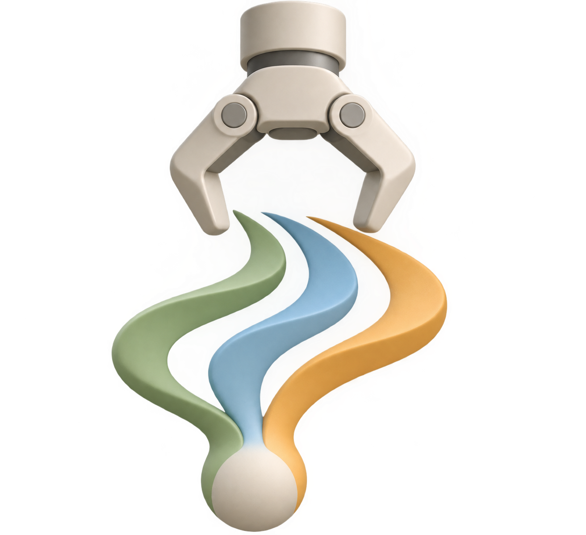
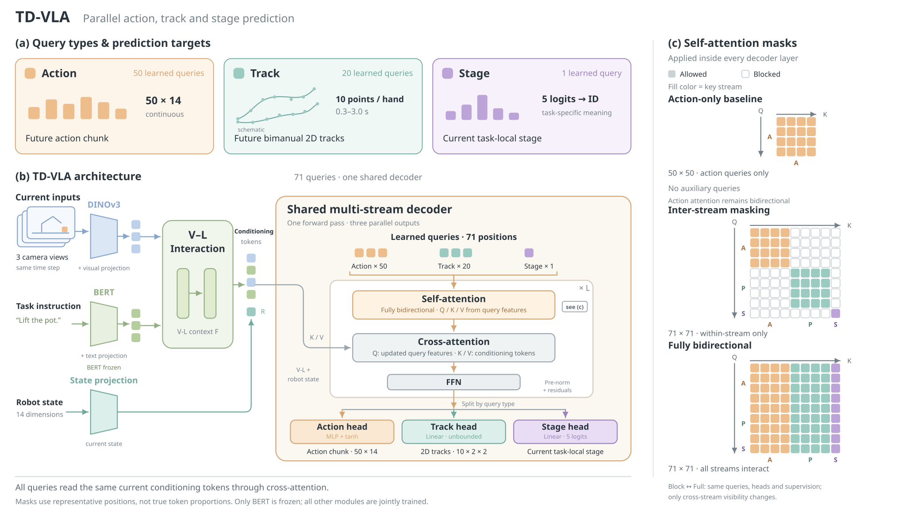

  
  <h1>TD-VLA</h1>
  
<strong>动作、轨迹与任务阶段的多流联合建模</strong>

  
中文 · <a href="README.en.md">English</a>

  
<a href="#方法概览">方法概览</a> · <a href="#三类输出">三类输出</a> · <a href="#文档导航">文档导航</a>

## 简介

机器人策略能否在预测动作的同时，表达未来目标运动与当前任务进度？TD-VLA 基于 TurboVLA 的并行动作块预测，引入 **Action、Track、Stage** 三类 queries，在共享 decoder 中联合建模连续动作、双臂夹爪二维目标轨迹与任务内阶段。

当前观测与任务指令提供共同条件，三条流通过隐藏特征交互，同步输出不同层次的预测。第一版采用全双向跨流注意力，不增加跨窗口历史模块；Track 与 Stage 为动作学习提供辅助监督。

## 方法概览

<a href="docs/model-architecture-v1.md">模型架构说明</a> · <a href="docs/data/p2-annotation-rules.md">Track / Stage 标注约定</a> · <a href="src/td_vla/models/multistream.py">模型实现</a>

多视角图像、任务指令与机器人状态构成条件输入。Action queries、Track queries 与 Stage query 进入共享 Transformer decoder，再由各自输出头生成动作块、目标轨迹及阶段 logits。这里的联合建模发生在并行 query 的隐藏特征之间，并非按动作采样结果逐流自回归生成。

## 三类输出

| 输出流 | 预测内容 | 监督来源 | 损失 |
| --- | --- | --- | --- |
| **Action** | 双臂连续动作块 | 原始专家动作，沿用基线动作定义与归一化 | L1 |
| **Track** | 左右夹爪两指中点的未来二维目标轨迹 | 成功专家轨迹的几何位置，投影到当前主相机坐标系 | Smooth L1 |
| **Stage** | 当前任务内的阶段类别 | 依据仿真 Oracle 转换事件划定阶段区间 | Cross-entropy |

Track 按实际时间戳选取未来目标点，其采样跨度独立于 Action chunk；左右臂均保留输出，遮挡或出画本身不构成无效标签。它表达专家目标运动，不等同于部署时机器人实际发生的轨迹。

Stage 使用共享五类分类头，但阶段编号的语义属于各自任务，不强行统一为跨任务技能。Oracle 与未来证据用于离线标签构建，不进入模型当前观测输入。标签有效性与预测解码规则见[当前 v4 标注约定](docs/data/p2-annotation-rules.md)，损失实现见 [losses.py](src/td_vla/training/losses.py)。

## 文档导航

**阅读顺序：** [模型架构](docs/model-architecture-v1.md) → [数据标注](docs/data/p2-annotation-rules.md) → [环境准备](docs/setup/uv-environments.md) → [训练入口](docs/setup/pretrained-training-v1.md)。

| 主题 | 文档入口 | 内容 |
| --- | --- | --- |
| 原始使用说明 | [完整使用指南](docs/usage-guide.md) | 原 README 全文，含开发命令、环境说明和原有记录链接 |
| 模型与接口 | [架构设计](docs/model-architecture-v1.md) · [模型实现说明](docs/setup/td-vla-v1-validation.md) | 共享 decoder、query 布局、输出头与实现边界 |
| 数据与标签 | [v4 标注约定](docs/data/p2-annotation-rules.md) · [标注记录](docs/setup/p2-annotation-v4-validation.md) | 几何投影、时间对齐、阶段事件与有效性掩码 |
| 数据版本 | [六任务入选版本](docs/setup/clean-six-50-selection.md) · [数据准备](docs/setup/clean-six-50.md) | 专家轨迹选择、版本与训练读取入口 |
| 环境配置 | [uv 环境说明](docs/setup/uv-environments.md) · [上游版本](configs/upstreams.json) · [资产来源](configs/assets.json) | 独立策略与仿真环境、锁定依赖和外部资源 |
| 训练与恢复 | [预训练初始化与训练](docs/setup/pretrained-training-v1.md) · [TurboVLA 基线训练](docs/setup/turbovla-baseline-training-v1.md) · [小样本复现](docs/setup/p2-pilot.md) | 初始化、启动及恢复流程 |
| 评测入口 | [六任务评测](docs/setup/clean-six-evaluation-v1.md) | 评测配置与操作说明 |
| 记录与结果 | [结果目录](docs/experiments/README.md) · [P2 记录](docs/setup/p2-validation.md) | 已有实验文档与验证边界 |
| 项目维护 | [路线图](docs/project-roadmap.md) · [工程约定](docs/engineering-conventions.md) | 研究安排、数据来源与产物管理 |

现有技术文档与记录保留原位。所有命令默认在仓库根目录执行；策略与仿真使用独立环境，不合并安装。

## 致谢与来源

本项目基于 [TurboVLA](https://github.com/H-EmbodVis/TurboVLA) 与 [RoboTwin](https://github.com/RoboTwin-Platform/RoboTwin) 开展多流建模研究。上游源码版本见 [configs/upstreams.json](configs/upstreams.json)，资产来源见 [configs/assets.json](configs/assets.json)。第三方代码与大型产物不随本仓库分发，其许可与版权遵循各自来源。
