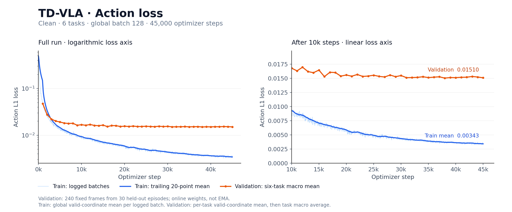
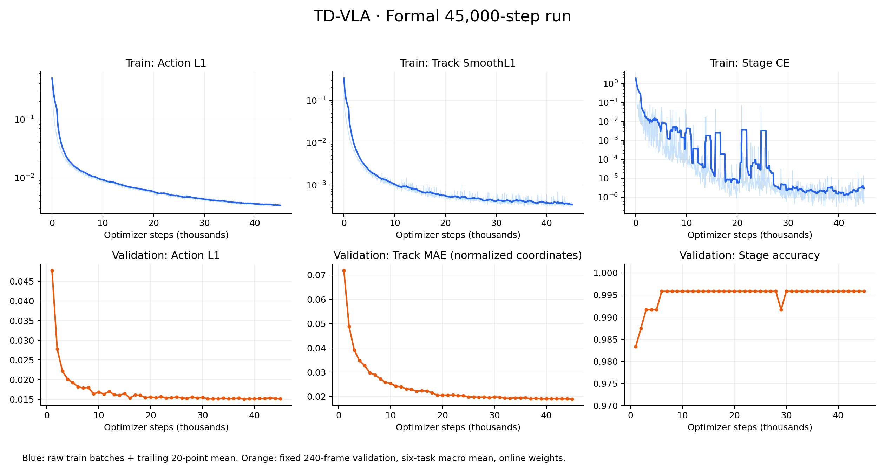

# TD-VLA Clean 六任务：正式训练结果

实验 ID：`td-vla-clean-full-v1`。状态：**已完成 45,000 步**。归档日期：2026-11-16。

本记录只包含正式训练结果及其复现材料，不收录短测、恢复测试、启动验收或中间调试输出。周期训练/验证日志属于本次完整正式运行，用于重建曲线。闭环评测与训练指标分开维护；本文不将离线指标解释为任务成功率。

## 实验配置

| 项目 | 设置 |
|---|---|
| 模型 | TD-VLA v1，Action/Track/Stage 共享全双向 decoder；无跨窗口记忆 |
| 数据 | RoboTwin Clean 六任务各 50 条成功轨迹；270 条训练、30 条验证，pilot-labels-v4 |
| 输入/输出 | 三视角 RGB、固定任务指令、关节状态；Action 50 步、Track 10 个时点×双臂、Stage 5 类共享分类头 |
| 初始化 | BERT、DINOv3 ViT-L/16、GroundingDINO 基础权重；未加载 RoboTwin 成品策略 |
| 冻结 | 仅 BERT；总参数 434,043,444，可训练参数 324,560,180 |
| 硬件 / batch | 2×RTX PRO 6000 Blackwell Max-Q；每卡 64，全局 128 |
| 训练预算 | 45,000 次更新，576 万个采样窗口；seed=42 |
| 优化器 | AdamW，betas=(0.9,0.95)，weight decay=0.01，梯度裁剪=1 |
| 学习率 | 1,000 步 warmup 至 5e-5，cosine 衰减至 5e-6 |
| 损失 | Action L1×1 + Track SmoothL1×0.1 + Stage CE×0.1 |
| EMA | 0.999；本文验证指标均来自在线权重 |
| 日志 / 验证 / 保存 | 每 50 步记录；每 1,000 步验证；每 5,000 步保存 |
| 时间（北京时间） | 2026-11-14 16:56:23 至 2026-11-15 10:41:01；约 17.74 小时 |
| 训练源码提交 | `bc39275`（原始启动记录） |

完整解析配置见 [config.json](logs/config.json)，实际启动命令见 [launch.json](logs/launch.json)，基础初始化映射见 [initialization.json](logs/initialization.json)。权重来源说明见 [基础初始化配方](../../setup/pretrained-training-v1.md)。

## 最终训练与验证结果

| 指标 | 45,000 步训练 batch | 最近 20 个训练记录点均值 | 45,000 步固定验证子集 |
|---|---:|---:|---:|
| Action L1 | 0.003446524 | 0.0034309318 | 0.015103286 |
| Track：训练 SmoothL1 / 验证 MAE | 0.00036007303 | 0.00034856831 | 0.018971221 |
| Stage：训练 CE / 验证准确率 | 5.2619578e-07 | 2.892421e-06 | 0.99583333 |

验证子集固定从每条验证轨迹均匀取 8 帧，共 240 帧（每任务 40 帧），不是整个验证集。Action L1 在归一化动作空间计算；Track MAE 在原图归一化坐标中计算，不是像素误差。每任务先按有效坐标汇总，再对六任务取宏平均；训练日志是采样 batch 的全局有效坐标平均，因此训练/验证曲线的统计口径不同。

Stage 截断准确率为 **239/240 = 99.58%**，原始分类准确率相同，越界率为 0%。训练 CE 和验证准确率不是同一种指标；Track SmoothL1 和 MAE 同样不能直接比较数值。

`summary.json` 中的 `validation_single_batch` 是训练结束后的独立 64 帧采样诊断，不是周期固定 240 帧验证结果。保留原始日志供追溯，本文最终验证统计统一以 `validation.jsonl` 的 45,000 步记录为准。

### 按任务的最终验证结果

| 任务 | Action L1 | Track MAE | Stage 准确率 |
|---|---:|---:|---:|
| `beat_block_hammer` | 0.004104 | 0.009615 | 100.0% |
| `handover_block` | 0.009536 | 0.017228 | 100.0% |
| `lift_pot` | 0.017183 | 0.013669 | 100.0% |
| `move_stapler_pad` | 0.030103 | 0.032134 | 97.5% |
| `place_object_basket` | 0.021779 | 0.027812 | 100.0% |
| `stack_blocks_two` | 0.007915 | 0.013369 | 100.0% |

## 曲线与观察



浅蓝为训练原始记录，深蓝为最近 20 个记录点的移动平均（约 1,000 个更新步），橙色为固定验证子集六任务宏平均。左图使用对数纵轴，右图放大 10,000 步之后的变化。



Action 训练损失持续下降，验证误差约在 20,000 步后改善趋缓。Stage 在固定验证子集上接近饱和。这些结果说明当前离线拟合情况，尚不足以证明辅助输出改善闭环成功率或跨任务泛化；需结合匹配预算的原版基线与相同协议评测分析。

## 日志、权重与复现

- [训练日志](logs/metrics.jsonl)：901 条正式记录。
- [周期验证日志](logs/validation.jsonl)：45 条记录，每条含六任务指标。
- [完成状态](logs/status.json)、[原始训练汇总](logs/summary.json)。
- 图像同时提供 PNG 与 SVG：[Action SVG](figures/action-loss.svg)、[多流 SVG](figures/multistream-curves.svg)。
- [归档校验清单](manifest.json)：文件 SHA256、原始来源、最终权重定位信息。
- 完整检查点保留在 F43-6000x2：`/root/autodl-tmp/td-vla/outputs/td-vla-clean-full-v1/`，共 9 个，不复制到 Git。最终权重为 `step-45000.pt`，包含模型、优化器、调度器、EMA、两卡 RNG 和恢复签名。

多流图复现命令（在仓库根目录运行）：

```bash
uv run --no-project --python .venv/bin/python --with matplotlib==3.10.3 \
  --index-url https://pypi.tuna.tsinghua.edu.cn/simple \
  docs/experiments/td-vla-clean-full-v1/plot_curves.py
```

Action 图沿用 `scripts/plot_action_loss.py`，输入本目录 `logs/`、输出 `figures/`。以上绘图仅读取正式日志，不重新执行训练或评测。
